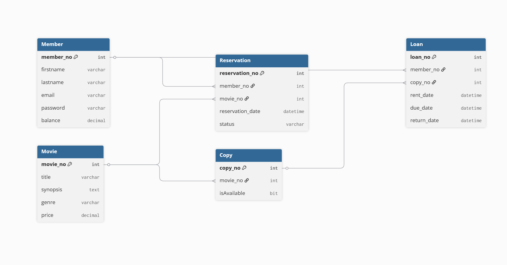

# Baza Danych - Wypożyczalnia Filmów z Systemem Rezerwacji i Przedłużeń
## Borys Rupa, Karolina Marmola
### Ogólna Idea:  
Nasza Baza Danych służy do kompleksowego przetwarzania i zarządzania informacjami o klientach, katalogu filmowym, fizycznych kopiach zasobów, aktywnych wypożyczeniach oraz kolejkach rezerwacji. Aplikacja łączy wydajną, relacyjną bazę danych MS SQL Server ze współbieżnymi mechanizmami transakcyjnymi oraz nowoczesnym, dynamicznym interfejsem użytkownika typu SPA (Single Page Application) napisanym w czystym JavaScript.

Link do google doc:
https://docs.google.com/document/d/1bsGYqGPAeA7jZ_Z1xq45B1AlIc-8j53bVEgcdN1deYY/edit?usp=sharing
Link do repozytorium:
https://github.com/Glitchtron/Data_Bases.git
### Tabele w bazie danych:

| Tabela | Opis |
|--------|------|
| **Member** | Informacje o użytkownikach/członkach i stanie ich konta |
| **Movie** | Informacje o samym filmie oraz jego cenie bazowej |
| **Copy** | Informacje o fizycznych kopiach filmu (egzemplarzach) |
| **Loan** | Informacje o aktywnych i zakończonych wypożyczeniach kopii przez członków |
| **Reservation** | Informacje o rezerwacjach danych filmów (oczekiwanie w kolejce FIFO) |

---

### Struktura Atrybutów (Schemat tabel)

#### Member:
| Pole | Typ/Rola | Opis |
|------|----------|------|
| `member_no` | PK | Unikalny identyfikator członka |
| `firstname` | varchar | Imię użytkownika |
| `lastname` | varchar | Nazwisko użytkownika |
| `email` | varchar | Adres e-mail (Login) |
| `password` | varchar | Hasło użytkownika |
| `balance` | decimal | Stan wirtualnego portfela klienta (Środki na koncie) |

#### Movie:
| Pole | Typ/Rola | Opis |
|------|----------|------|
| `movie_no` | PK | Unikalny identyfikator filmu |
| `title` | varchar | Tytuł filmu |
| `synopsis` | text | Opis fabuły filmu |
| `genre` | varchar | Gatunek filmowy |
| `price` | decimal | Cena za standardowe wypożyczenie filmu / rezerwację |

#### Copy:
| Pole | Typ/Rola | Opis |
|------|----------|------|
| `copy_no` | PK | Unikalny identyfikator egzemplarza (kopii) |
| `movie_no` | FK | Powiązanie z konkretnym tytułem z tabeli Movie |
| `isAvailable` | bit (0/1) | Stan dostępności (1 = w bibliotece, 0 = wypożyczony/zajęty) |

#### Loan:
| Pole | Typ/Rola | Opis |
|------|----------|------|
| `loan_no` | PK | Unikalny identyfikator operacji wypożyczenia |
| `member_no` | FK | Powiązanie z kontem wypożyczającego użytkownika |
| `copy_no` | FK | Powiązanie z konkretnym wypożyczonym egzemplarzem filmu |
| `rent_date` | datetime | Data i godzina rozpoczęcia wypożyczenia |
| `due_date` | datetime | Wyliczony termin zwrotu filmu |
| `return_date` | datetime | Faktyczna data oddania filmu (wartość `NULL` jeśli niewrócony) |

#### Reservation:
| Pole | Typ/Rola | Opis |
|------|----------|------|
| `reservation_no` | PK | Unikalny identyfikator operacji rezerwacji |
| `member_no` | FK | Powiązanie z kontem oczekującego użytkownika |
| `movie_no` | FK | Powiązanie z filmem, na który użytkownik czeka |
| `reservation_date` | datetime | Dokładna data i godzina złożenia rezerwacji (kolejka FIFO) |
| `status` | varchar | Status rezerwacji (`ACTIVE` - oczekiwanie, `COMPLETED` - zrealizowana) |

---
### Diagram

---
### Kluczowe Funkcjonalności Systemu

1. **Zarządzanie Autoryzacją (SPA):** Dynamiczny system logowania i obsługi sesji bez przeładowywania strony, integrujący dane użytkownika z jego saldem portfela.
2. **Katalog z Wyszukiwarką Live-Search:** Generowanie interaktywnych kart filmowych na żywo na podstawie wpisanej frazy lub wybranego gatunku.
3. **Zintegrowany Koszyk i Rezerwacje (Przedpłata):** Możliwość zamówienia filmów dostępnych (od razu trafiają do biblioteki) oraz niedostępnych. W przypadku braku kopii system pobiera przedpłatę, a transakcja kończy się bezpiecznym zapisem do kolejki rezerwacji.
4. **Automatyczny Zwrot i Obsługa Kolejki FIFO:** Gdy film jest zwracany procedurą `sp_return_movie`, system natychmiast sprawdza, czy ktoś go rezerwuje. Jeśli tak, film od razu zmienia właściciela, pomijając powrót do ogólnego katalogu.
5. **Płatne Przedłużenia Czasu Wypożyczenia:** Możliwość mikropłatności (2.00 PLN) za pomocą dedykowanej procedury transakcyjnej `p_prolong_loan`, przesuwającej termin `due_date` o dokładnie 1 dobę.
6. **Panel „Najpopularniejsze Filmy” (Ranking):** Dedykowana zakładka w menu aplikacji, która pozwala użytkownikom na wgląd w zestawienie najchętniej oglądanych pozycji. Interfejs dynamicznie (bez przeładowywania strony) pobiera dane z widoku bazodanowego `vw_popular_movies`. Jeśli baza zawiera dane o transakcjach, system generuje czytelną tabelę rankingową prezentującą pozycję na liście (od `#1` w górę), oryginalny tytuł filmu oraz łączną sumaryczną liczbę jego wypożyczeń (`total_loans`). W przypadku braku jakichkolwiek transakcji w systemie, widok automatycznie wyświetla komunikat o braku danych.
---

### Elementy Logiki Bazy Danych (Widoki i Procedury)

Aby zoptymalizować zapytania oraz zabezpieczyć spójność danych podczas złożonych operacji współbieżnych, w bazie danych zaimplementowano dedykowane widoki (Views) oraz podprogramy transakcyjne (Routines).

#### Widoki (Views):

| Nazwa Widoku | Przeznaczenie i Opis |
|--------------|----------------------|
| `vw_active_loans` | Zwraca listę wszystkich trwających wypożyczeń (rekordy, gdzie `return_date` jest puste). |
| `vw_available_movies` | Wyświetla zaktualizowany katalog filmów, pokazując wyłącznie te tytuły, które posiadają aktualnie dostępne do wypożyczenia kopie (`isAvailable = 1`). |
| `vw_member_loans` | Agreguje pełną historię wypożyczeń (zarówno aktywnych, jak i zakończonych) przypisaną do konkretnych użytkowników. |
| `vw_overdue_loans` | Wyciąga listę wypożyczeń po terminie (gdzie dzisiejsza data przekracza `due_date`, a film nie został zwrócony). Kluczowe dla systemu kar i blokad. |
| `vw_popular_movies` | Widok raportujący. Wykorzystuje funkcje agregujące do zliczenia wypożyczeń per film, tworząc ranking najczęściej wybieranych tytułów. |
| `vw_reservations` | Zbiorczy podgląd wszystkich aktywnych rezerwacji w systemie wraz z ich aktualnym statusem oczekiwania w kolejce. |

#### Podprogramy (Routines):

* **`f_is_movie_available`** Funkcja skalarna przyjmująca jako parametr identyfikator filmu. Sprawdza w tabeli `Copy` stan inwentarza i zwraca wartość logiczną (1 = dostępny, 0 = niedostępny), co pozwala frontendowi na dynamiczną zmianę etykiet przycisków w interfejsie.

* **`p_rent_movie`** Główna procedura transakcyjna obsługująca checkout. Przyjmuje ID użytkownika oraz ID filmu. W ramach jednej transakcji pobiera cenę filmu i zakłada blokadę na wiersz użytkownika (`WITH (UPDLOCK, ROWLOCK)`), zapobiegając błędom współbieżności. Jeśli konto posiada wystarczające środki, pobiera opłatę (zasada przedpłaty):
  - Jeśli kopia jest dostępna: ustawia `isAvailable = 0`, tworzy rekord w tabeli `Loan` i zwraca status `LOAN_CREATED`.
  - Jeśli brak kopii: tworzy rekord w tabeli `Reservation` ze statusem `ACTIVE` i zwraca status `RESERVATION_CREATED`.

* **`sp_return_movie`** Procedura zamykająca cykl życia wypożyczenia. Przyjmuje numer operacji (`loan_no`) oraz aktualizuje datę oddania (`return_date`) na obecną. Następnie sprawdza, czy istnieje najstarsza aktywna rezerwacja na dany film (`ORDER BY reservation_date ASC`). Jeśli tak – realizuje ją natychmiastowo, tworząc nowe wypożyczenie i zamykając rezerwację. Jeśli nie – zwalnia przypisaną kopię w tabeli `Copy` (`isAvailable = 1`), przywracając film do ogólnej puli.

* **`p_prolong_loan`** Procedura realizująca mikropłatność za czas dostępu do multimediów. Wykorzystuje dyrektywę `SET XACT_ABORT ON` gwarantującą pełne wycofanie transakcji przy jakimkolwiek błędzie. Sprawdza, czy użytkownik posiada minimum 2.00 PLN, potrąca kwotę z salda, a następnie modyfikuje tabelę `Loan`, wykonując bezpieczną operację dodania doby: `DATEADD(day, 1, due_date)`.

---

### Przypadki Testowe (Scenariusze)

| ID | Nazwa Przypadku Testowego | Krok Testowy / Warunek Wejściowy | Oczekiwany Rezultat Systemu |
|----|---------------------------|----------------------------------|-----------------------------|
| **1** | Brak dostępu bez autoryzacji | Próba wywołania widoków aplikacji bez podania danych logowania. | System ukrywa katalog, wyświetla błąd autoryzacji w formacie alertu i przekierowuje użytkownika do ekranu logowania. |
| **2** | Udane Logowanie | Podanie prawidłowego adresu e-mail oraz hasła. | Użytkownik zostaje przypisany do globalnej sesji. Pasek boczny/nawigacyjny prawidłowo renderuje jego dane oraz aktualne saldo pobrane z tabeli `Member`. |
| **3** | Wyszukiwanie Filmu | Weryfikacja działania wyszukiwarki na żywo (Live-Search). | Siatka filmów automatycznie ukrywa nietrafione pozycje i pokazuje wyłącznie pasujące tytuły lub gatunki bez konieczności przeładowywania strony. |
| **4** | Obsługa braku kopii (Rezerwacja) | Próba interakcji z filmem, którego fizyczny zapas kopii wynosi obecnie 0. | Przycisk na karcie filmu dynamicznie zmienia etykietę na „REZERWUJ (PRZEDPŁATA)”. Projekt jest normalnie dodawany do koszyka jako rezerwacja. |
| **5** | Złożenie zamówienia z brakiem środków | Próba finalizacji transakcji w koszyku, gdy łączna kwota zakupów przekracza wirtualne saldo użytkownika. | Transakcja zostaje zablokowana przez walidację systemową. Wyświetla się alert informujący o braku środków, a saldo nie zostaje naruszone. |
| **6** | Pomyślne wypożyczenie i rezerwacja | Realizacja transakcji mieszanej (jeden dostępny oraz jeden niedostępny film) przy wystarczających środkach na koncie. | Saldo użytkownika odpowiednio maleje, koszyk zostaje wyczyszczony. W zakładce „Moje Wypożyczenia” film dostępny trafia do tabeli aktywnej z datą zwrotu, a film niedostępny pojawia się w nowej sekcji rezerwacji ze statusem „OCZEKUJE NA ZWROT KOPII”. |
| **7** | Automatyczne przejście rezerwacji w wypożyczenie | Użytkownik A posiada aktywną rezerwację na film X. Użytkownik B klika przycisk „Zwróć” dla tego samego filmu. | Procedura `sp_return_movie` wykrywa rezerwację. Film automatycznie znika z tabeli rezerwacji Użytkownika A i pojawia się w jego tabeli aktywnych wypożyczeń jako dostępny do odtworzenia. Kopia fizyczna pozostaje zajęta. |
| **8** | Współbieżny dostęp do ostatniej kopii zasobu | Dwaj użytkownicy jednocześnie próbują sfinalizować zamówienie na tę samą, ostatnią dostępną kopię filmu. | Blokada row-level bazy danych (`UPDLOCK`) pozwala pierwszej przetworzonej transakcji zakończyć się sukcesem (tworzy `Loan`). Zapytanie drugiego użytkownika zostaje bezpiecznie obsłużone i automatycznie przekierowane na ścieżkę rezerwacji (tworzy `Reservation`) bez błędów aplikacji. |
| **9** | Płatne przedłużenie czasu wypożyczenia | Użytkownik klika przycisk „⏳ +1 Dzień (2 zł)” przy swoim aktywnym wypożyczeniu. | System natychmiast wywołuje procedurę `p_prolong_loan`, pobiera kwotę z konta użytkownika, a data w kolumnie „Wygasa” przesuwa się o dokładnie 24 godziny w przód. Wyświetla się komunikat potwierdzający sukces operacji. |
| **10** | Walidacja podwójnego dodania do koszyka | Próba ponownego dodania do koszyka filmu, który użytkownik już aktualnie wypożycza, rezerwuje lub posiada w koszyku. | Aplikacja JavaScript przechwytuje zdarzenie, blokuje dodanie rekordu i wyświetla komunikat ostrzegawczy: „Ten film jest już w Twoim koszyku lub bibliotece!”. Licznik na ikonie koszyka w pasku nawigacyjnym pozostaje bez zmian. |